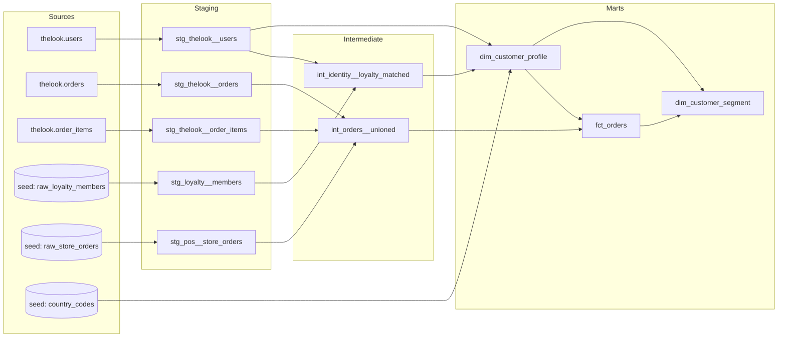
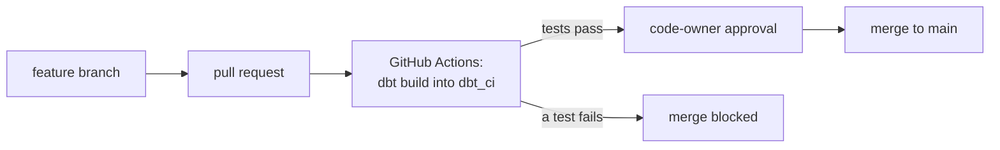

# Unified customer profile on BigQuery with dbt

A dbt Core project that builds a **unified customer profile** from three source systems: an online store, a loyalty program and in-store tills. It resolves which records belong to the same person, puts every order from both channels in one fact table, and assigns each customer a rules-based segment. Everything is tested, and changes reach `main` only through a reviewed pull request with a passing CI build.

I built it to learn dbt properly by solving a realistic retail customer-data problem, not by following a tutorial dataset. This README covers what I built, the decisions behind it, and what the data taught me along the way.

> **Scope, honestly:** a learning project, not a production system. It runs on the free BigQuery sandbox, so some features I designed (incremental loading, snapshots) are documented here but not switched on. See [What I'd do next](#what-id-do-next).

---

## At a glance

| | |
|---|---|
| **Stack** | dbt Core (`dbt-bigquery` 1.12) · Google BigQuery · GitHub Actions |
| **Data** | `bigquery-public-data.thelook_ecommerce` (a synthetic online clothing store, refreshed daily) + seed CSVs for the loyalty and store systems |
| **Models** | 10: 5 staging, 2 intermediate, 3 marts |
| **Tests** | 31 data tests (generic and singular), run on every pull request |
| **Output** | 100,003 resolved customers · 124,679 orders across two channels · one segment per customer |

*Row counts are from 27–28 Oct 2026. thelook adds orders every day, so they grow over time.*

---

## Architecture



| Layer | Rule I followed | Materialized as |
|---|---|---|
| **Staging** | One source in, one model out. Rename, recast, normalise. No joins, no business logic | Views |
| **Intermediate** | Joins and matching logic that marts build on | Views (so I can query them while debugging) |
| **Marts** | The tables people use: one clear grain each, documented and tested | Tables |

### The source systems

thelook is the online store and the system of record. I added two "satellite" systems as seed files, built around **real thelook customers** and given the kinds of problems real source data has:

| Seed | Represents | Problems built in on purpose |
|---|---|---|
| `raw_loyalty_members` | A loyalty card program | Upper/mixed-case emails, one person registered twice, a country that disagrees with the online store, a missing phone, members with no online account |
| `raw_store_orders` | In-store tills | Guest checkouts (email only), an order for a customer ID that doesn't exist, an anonymous cash sale, an unusually large amount |
| `country_codes` | Reference data | Maps every spelling seen in the sources (`Germany`/`Deutschland`, `Spain`/`España`) to ISO codes |

---

## The marts

### `dim_customer_profile`: one row per real person

**Grain:** person. **Rows:** 100,003.

Profiling the data before modelling it changed the design completely:

> thelook has **100,000 accounts but only 83,648 distinct emails**, and the shared emails belong to **different people**. One email is shared by three customers named Thomas Clark, aged 21, 48 and 70, in two countries. Another is shared by 19 accounts. About **27% of accounts share an email** with at least one other account.

Matching on email alone would have merged strangers into one profile. So the identity rule is:

1. **Every online account is its own person.** The store's own ID is the anchor.
2. **A loyalty member is merged into an online account only when the email matches exactly one account.**
3. **If the email matches several accounts, the match is ambiguous:** the member stays a separate person and is flagged, rather than being guessed into one of them.

**Why "don't guess":** wrongly merging two people means one customer could see another's purchase history, which is a privacy incident. A missed merge only means a slightly less complete profile. **Over-merging is worse than under-merging.**

Every profile records how it was resolved:

| `match_status` | Meaning | Count |
|---|---|---|
| `web_only` | Online account, no loyalty membership | 99,996 |
| `matched` | Online account merged with exactly one loyalty membership | 4 |
| `loyalty_only` | Loyalty member with no online account | 2 |
| `ambiguous` | Loyalty email matches several online accounts, so it's kept separate | 1 |

Other decisions in this model:

- **Survivorship on country:** the loyalty country wins, because members maintain it themselves; a web signup country is a one-off. When the two disagree, `has_country_conflict = true` flags it instead of hiding it.
- **`source_count`:** how many systems confirm this person (1 or 2). A data-quality signal built into the model.
- **`person_key`:** an MD5 hash of `web:<id>` or `loyalty:<email>`. It's stable across rebuilds, needs no package, and the prefix keeps the two kinds of key from ever colliding.
- **Duplicates within one system are handled first:** a person registered twice in the loyalty program becomes one row, keeping both member numbers.

### `fct_orders`: every order, both channels

**Grain:** order. **Rows:** 124,679 (124,669 online + 10 store).

- Online order amounts are **summed from order items** (thelook stores price per item, not per order) and cast from `FLOAT64` to `NUMERIC` in staging, so money adds up exactly.
- Online IDs are numbers and store IDs look like `S-9001`, so `order_id` is a string for both channels.
- **Cancelled and returned orders are kept**, with an `is_revenue` flag. Deleting them would make the return rate impossible to measure.
- **Every order links to a person:** by customer ID first, then by guest email, and only when that email belongs to exactly one person. All online orders resolve. Two store orders correctly don't: the order for a customer who doesn't exist, and the anonymous cash sale. Their revenue stays in the table but belongs to nobody.

### `dim_customer_segment`: rules, not a model

**Grain:** person (every profile gets exactly one segment, including people who never bought).

Rules are applied in order, and **the order is a business decision**:

| # | Segment | Rule | People | Avg lifetime value |
|---|---|---|---|---|
| 1 | `no_purchase` | No completed orders | 34,212 | $0 |
| 2 | `lapsed` | Last order more than 365 days ago, even if they were high value | 35,241 | $112 |
| 3 | `high_value` | Active, lifetime value ≥ $190 | 7,047 | $328 |
| 4 | `repeat` | Active, 2+ orders | 6,790 | $110 |
| 5 | `single_purchase` | Everyone else who bought | 16,713 | $63 |

- **Thresholds come from the data:** $190 is roughly the top 10% of buyers by lifetime value.
- **They're project variables** (`segment_high_value_usd`, `segment_lapsed_days` in `dbt_project.yml`), not numbers buried in SQL, so the business can change them in one reviewed place.
- **Why rules instead of a clustering model:** the business can own and adjust the thresholds, any customer's segment can be explained in one sentence, and the logic is auditable. For customer classification, explainability usually matters more than a small gain in accuracy.

---

## Data quality

**31 tests** run on every build. Beyond the usual `unique` / `not_null` / `accepted_values` / `relationships`:

| Test | Why it exists |
|---|---|
| `unique` on `web_customer_id` in the profile | Catches a join that fans out, e.g. two loyalty rows attaching to one account |
| `assert_profile_keeps_every_web_account` | Identity resolution must never lose a customer |
| `assert_order_revenue_reconciles` | Online revenue in `fct_orders` must equal the sum of the source line items |
| `relationships` from orders to customers, at **warn** severity | The orphan store order is a known, documented case. It should be visible, but not block the build |

Choosing **warn vs error** per test is deliberate: a rule that blocks a build is a contract; a rule that warns is a signal for someone to look at.

### Four problems I found, and what they taught me

These are the most useful part of the project for me. None of them showed up as an error message.

1. **Email isn't an identity key, even inside one system.** It's the profiling finding described above. **Lesson:** profile before you model. My first design would have quietly merged thousands of strangers.

2. **The free BigQuery sandbox silently deleted 87% of my orders.** My first `fct_orders` was partitioned by order date. The sandbox expires partitions older than 60 days, so the table held 15,568 rows instead of 124,679, and **every test still passed**, because none of them checked totals. **Lesson:** reconciliation tests (does the output add up to the input?) catch problems that row-level tests can't. I added one.

3. **My reconciliation test was wrong at first and reported a $103k mismatch.** The cause wasn't the data: in thelook, an order item's timestamp can differ from its order's by up to about four days. My test filtered each side by its own date column, so it compared different sets of orders. **Lesson:** when a test fails, check the test as carefully as the data. Both sides now cut off by the order's date, and the test passes.

4. **Future-dated events would have broken incremental loading.** More than 1,200 orders have delivery or return dates in the future (it's synthetic data). An incremental model using "latest timestamp seen" as its watermark would have jumped into the future and **silently skipped every new order**. **Lesson:** design the watermark around what the data actually contains. My design ignores future-dated events and re-checks a 3-day window.

---

## How changes get to `main`



- **`main` is protected:** no direct pushes, every change goes through a pull request, and a pull request needs approval from the code owner.
- **CI on every pull request:** GitHub Actions installs dbt on a clean machine and runs `dbt build` (seeds, models and every test) into a separate `dbt_ci` dataset. My own development builds go into a separate dev dataset, so testing a change never touches anyone else's data.
- **Credentials:** locally I authenticate with my own Google login (OAuth). CI uses a service-account key stored as a GitHub secret. The repo contains a CI-only `ci/profiles.yml` that reads the key from an environment variable at runtime, so **no secret is ever committed**.
- I proved the setup works by opening a pull request with a deliberately incomplete `accepted_values` test, watching CI go red, investigating the real values, and fixing it to green.

---

## Run it yourself

**Requirements:** Python 3.11–3.13 (not 3.14, which `dbt-bigquery` doesn't support yet), a Google Cloud project with BigQuery, and the Google Cloud CLI.

```bash
python -m venv .venv
.venv\Scripts\activate                     # Windows; on macOS/Linux: source .venv/bin/activate
pip install dbt-bigquery

gcloud auth application-default login      # the login dbt uses
```

Create `~/.dbt/profiles.yml`:

```yaml
ecommerce_project:
  target: dev
  outputs:
    dev:
      type: bigquery
      method: oauth
      project: YOUR-GCP-PROJECT-ID
      dataset: dbt_dev
      location: US            # must be US: thelook is stored in the US multi-region
      threads: 4
```

```bash
dbt debug          # check the connection
dbt build          # seeds, models and tests
dbt docs generate && dbt docs serve    # browse the lineage graph and documentation
```

The largest model processes about 15 MB per build, a tiny fraction of BigQuery's free 1 TiB of queries a month.

---

## What I'd do next

These are designed and documented, but switched off because the BigQuery sandbox doesn't allow `MERGE` and deletes partitions older than 60 days:

- **Incremental `fct_orders`:** `merge` on `order_id`, partitioned by date. `merge` rather than `insert_overwrite`, because order status changes after purchase (processing → shipped → returned), so old rows need updating.
- **Snapshot (SCD type 2)** on the profile, to keep a history of country and email changes.
- **A production dataset** built by a deploy workflow on merge and on a daily schedule.
- **A Data Studio dashboard** on top of the marts.
- **AI enrichment in BigQuery** (`AI.CLASSIFY` on product names, as an incremental model so each product is classified once), with its output tested and its accuracy measured against hand-labelled samples.

---

## What I learned

- **Profile first.** Every major design decision here came from a query I ran *before* writing the model.
- **Staging discipline pays off.** Because normalisation (lower-cased emails, numeric money, consistent IDs) happens once in staging, the matching logic downstream stays simple.
- **Business rules belong in the open.** Survivorship, the identity rule, segment order and thresholds are all written down in model descriptions and project variables, where a reviewer can challenge them.
- **Tests that pass aren't proof.** It took a reconciliation test to show that most of the data was missing.
- **The process is part of the product.** Protected `main`, reviewed pull requests and CI turn "it works on my laptop" into evidence that anyone can check.
